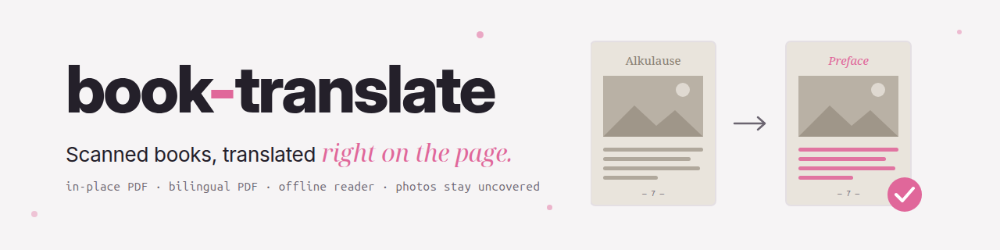
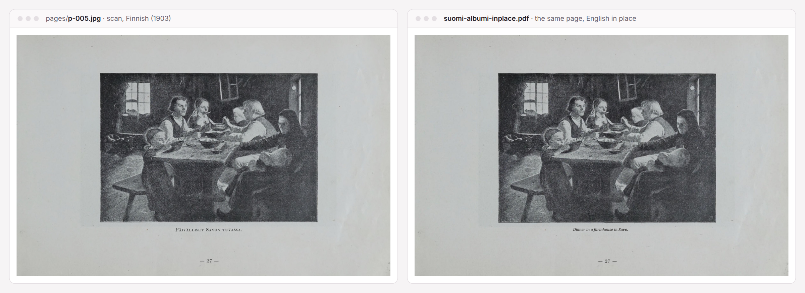
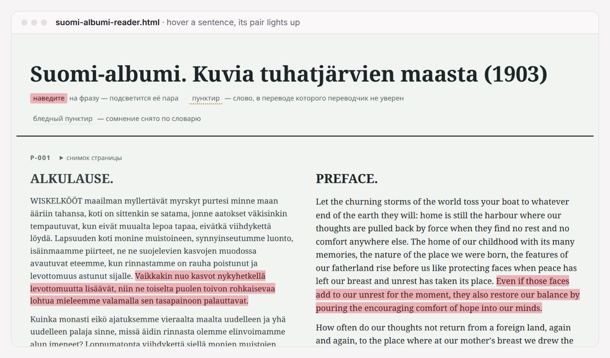
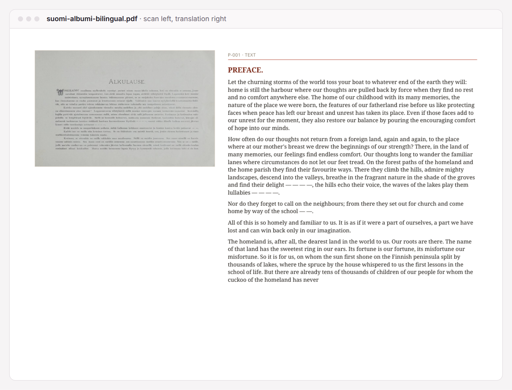

<p align="center">
  <picture>
    <source media="(prefers-color-scheme: dark)" srcset="docs/img/banner-dark.png">
    
  </picture>
</p>

<p align="center">
  <a href="https://github.com/olyamasaeva/book-translate/actions/workflows/tests.yml"></a>
  <a href="LICENSE"></a>
  
  
</p>

<p align="center"><a href="SKILL.md"><picture><source media="(prefers-color-scheme: dark)" srcset="docs/img/btn-skill-dark.png"></picture></a>&nbsp;<a href="#quick-start"><picture><source media="(prefers-color-scheme: dark)" srcset="docs/img/btn-start-dark.png"></picture></a>&nbsp;<a href="#manual"><picture><source media="(prefers-color-scheme: dark)" srcset="docs/img/btn-manual-dark.png"></picture></a></p>

> [!NOTE]
> **The text is read from the page image, and the translation goes back onto the page without covering a single photo.** Built on a 222-page Finnish book about folk costume with sewing patterns and a chapter of Finnish and Karelian wedding songs, both translated into Russian.

<h3 align="center">The book exists only as scans. Read it in your language anyway.</h3>

<p align="center"><b>book-translate</b> is a Claude Code skill and a command-line tool for books that exist only as scans.<br>Claude reads the page images and translates them; the tool lays the translation back onto the original pages.</p>

<p align="center"><a href="#quick-start">Quick start</a> · <a href="#why">Why</a> · <a href="#what-you-get">What you get</a> · <a href="#not-yet">What it doesn't do yet</a> · <a href="#faq">Questions</a> · <a href="#manual">The manual</a></p>

<a id="quick-start"></a>

## 🚀 Running in two minutes

```bash
git clone https://github.com/olyamasaeva/book-translate ~/.claude/skills/book-translate
cd ~/.claude/skills/book-translate && uv sync
```

Then ask Claude Code, for example:

- "Translate book.pdf from German into English, keep the photos"
- "Make a bilingual PDF of this scanned chapter"
- "Переведи эту книгу с финского на русский прямо на странице"

or call the skill directly: `/book-translate`. The workflow Claude follows is in
[SKILL.md](SKILL.md). System dependencies are listed under [Usage without Claude Code](#cli).

<a id="why"></a>

## 💡 How it differs from existing PDF translators

Tools such as PDFMathTranslate and BabelDOC work best on PDFs that already have a text
layer, and they place the translation on a white background. This project targets a
different case:

- The text is read from the page image. OCR is used only to find where each text block
  sits, never as the source of the translation.
- A translation box never lands on a photo, including light colour photos such as silk or
  embroidery.
- On sewing patterns the boxes are transparent. The original letters are erased from the
  scan, and grid lines and long strokes are kept.
- A one-line caption on a skewed scan gets a rotated box at the same angle.
- Footnotes are split one per line ("number — text"), and quotes and songs spanning
  several stanzas are recognised as one block.
- The `check` step reads the final layout from Chrome and counts the defects: boxes on
  photos, overlapping boxes, empty boxes, text shrunk below 75%, text that did not fit,
  and confidently recognised words of the original that are still visible. The visible-word
  count comes from the OCR of the scan, so it works the same for any source language.

<a id="what-you-get"></a>

## 📚 A scan in, three files out

<picture><source media="(prefers-color-scheme: dark)" srcset="docs/img/shot-hero-dark.png"></picture>

| | |
|---|---|
| 📄 **In-place PDF** | The original text on each page is replaced with the translation in the same layout. |
| 📖 **Bilingual PDF** | The page scan on the left, the translation on the right. |
| 🔦 **Reader** | One offline HTML file, original and translation side by side; hovering a sentence highlights its counterpart. |
| ❓ **Doubts** | Words the translator was unsure about carry a tooltip with the guess and, once checked, the dictionary verdict. |
| ✅ **Check** | Counts boxes on photos, overlaps, shrunk or overflowing text and original words still visible. |
| 🗜️ **Compress** | Downsamples scans to 150 dpi for sending. |

<details>
<summary><b>See the reader and the bilingual PDF</b></summary>

<table>
<tr>
<td width="50%" valign="top"><picture><source media="(prefers-color-scheme: dark)" srcset="docs/img/shot-reader-dark.png"></picture><br><b>Reader</b> · <sub>Hover a sentence and its pair lights up.</sub></td>
<td width="50%" valign="top"><picture><source media="(prefers-color-scheme: dark)" srcset="docs/img/shot-bilingual-dark.png"></picture><br><b>Bilingual PDF</b> · <sub>Scan left, translation right.</sub></td>
</tr>
</table>

</details>

<sub>The pictures show a five-page Finnish → English demo built with this tool from <i>Suomi-albumi: kuvia tuhatjärvien maasta</i> (Hancock, Michigan, 1903), a public-domain album from the <a href="https://archive.org/details/suomialbumikuvia00unse">Internet Archive</a>. The reader's legend is in Russian in this build.</sub>

<a id="not-yet"></a>

## 🧭 What it doesn't do yet

- **Right-to-left and vertical scripts** are not supported. Spreads and columns are always
  ordered left to right, and documents have no `dir` setting.
- **Scripts without spaces** between words (Chinese, Japanese, Thai) cannot be shortened
  word by word: the fitting script splits text on spaces.
- **Caches don't know their inputs.** The OCR and layout caches do not record which scan,
  language or settings they were made with. Delete `layout/` after replacing scans or
  changing `ocr_lang`.
- **One book per process.** Module state is set per book with `configure()`.
- **Wide letter spacing** in some books printed before 1920 breaks block detection: lines
  are split into single words and only partly covered. Typeset such pages from scratch
  with `retypeset_ranges`.
- **The CLI does not translate.** Pages are translated by Claude through the skill, by
  another model or by a person.

<a id="faq"></a>

## ❓ Questions people ask first

**How do I translate a scanned PDF that has no text layer?**
Split it into page images with `book-translate pages`, translate each page from the image
(Claude does this when you use the skill), then build the PDFs. OCR is used only to locate
text on the page, so a poor scan does not spoil the translation.

**Can I keep the original layout and photos?**
Yes, this is what the in-place PDF is for. Translation boxes never cover photos or
drawings; on sewing patterns and grids the boxes are transparent and the grid lines stay.
If the translation is longer than the original, boxes grow into the white margins first.

**Which languages are supported?**
Any left-to-right source language that Tesseract can read for layout, into any
left-to-right target language. Whole books so far: Finnish → Russian and Finnish with
Karelian → Russian. The pictures above are a five-page Finnish → English demo.

**Do I need an API key?**
No. With Claude Code the translation happens in your Claude Code session. The CLI runs
offline.

**Can I publish the translation?**
Only if you have the rights: the book is in the public domain, it is your own text, or the
author agreed. Scans and translations are never committed to this repository.

<a id="manual"></a>

## 📖 The manual

### Pipeline

```
book.pdf ──pages──► pages/p-NNN[a|b].jpg
                         │
           translation by reading the page images
           (a multimodal model or a human)
                         ▼
               translation/p-NNN.json ──bilingual──► bilingual PDF
                         │
       layout (text blocks, ink and photo masks, OCR per block)
                         ▼
               layout/blocks, layout/rotated ──inplace──► in-place PDF
                                                              │
                                                     check ◄──┘
```

<a id="cli"></a>

### Usage without Claude Code

The CLI does not call any translation service. The page translations can come from Claude
(see [SKILL.md](SKILL.md)), from another model or from a person; the tool only needs one
JSON file per page.

```bash
uv sync
cp conf/book.example.yaml data/<book>/book.yaml       # then edit it
uv run book-translate pages     --book data/<book>/book.yaml book.pdf
# translate the pages into data/<book>/translation/ (see below)
uv run book-translate bilingual --book data/<book>/book.yaml [--force]
nice -n 19 uv run book-translate layout --book data/<book>/book.yaml --jobs 2
uv run book-translate inplace   --book data/<book>/book.yaml [--pages p-023a,p-041b --out sub.pdf] [--force]
uv run book-translate check     --book data/<book>/book.yaml
uv run book-translate reader    --book data/<book>/book.yaml [--force]   # offline HTML: original and translation side by side, hover highlights pairs
uv run book-translate compress  finished.pdf          # downsample scans to 150 dpi → finished-compressed.pdf
```

`pages` splits two-page spreads into `a` (left) and `b` (right) halves and reports whether
the PDF has a text layer. `layout` is slow, a few seconds per page, and caches its
results in `layout/`. Use `inplace --pages` to rebuild only the pages you are fixing.
An existing PDF is never overwritten unless you pass `--force`. The HTML that Chrome
prints is kept in `<workdir>/build/`, and `check` reads it from there.

System dependencies: poppler (`pdftoppm`, `pdftotext`), Tesseract 5 with the source
language installed, Chrome or Chromium, and Ghostscript. Chrome is looked up under the
usual names and install paths on Linux, macOS and Windows. Tesseract is taken from
`PATH` unless the config points elsewhere. If a program is missing or fails, the command
stops with its name and error output instead of producing an empty result.

### Book config

Everything specific to a book lives in `book.yaml`. Relative paths are resolved from the
file's own directory. The book's language has to be set explicitly, and the config will
not load without it:

| Field | Meaning |
|---|---|
| `ocr_lang` | Tesseract language code of the original (`eng`, `deu`, `rus`, …) |
| `source_lower`, `source_upper` | alphabet of the original, used to recognise its words on the scan |
| `target_letters` | alphabet of the translation |
| `target_lang` | language of the translation, used as the documents' `lang` |
| `notes_headings` | heading of the footnotes block in the translation |
| `page_width_mm`, `page_height_mm` | page size; the height defaults to the median aspect ratio of the scans |
| `spreads` | `auto` (split images wider than 1.1× their height), `always` or `never` |
| `quote_open`, `quote_close` | quotation marks of both languages |
| `attribution_source`, `attribution_target` | words that introduce a quote's attribution ("Riddle", "Song") |
| `source_names` | author names in footnotes and their spelling in the target language |
| `service_words`, `credit_words` | units and photo-credit words of the original |
| `retypeset_kinds`, `retypeset_ranges` | pages to typeset from scratch, such as the contents, glossaries and tables |
| `labels` | words printed in the PDFs ("p.", "not translated yet", page kinds); English by default |
| `editorial_patterns` | regexes removed from the translation, e.g. translator's markers like "[summary]" |
| `note_boilerplate` | fragments that drop service sentences from translator's notes |
| `title` | title page of the bilingual PDF, as HTML |
| `tesseract`, `chrome` | which programs to run |

See `conf/book.example.yaml`.

### Page translation format

One JSON file per page:

```json
{"page": "p-007a",
 "printed": "12",
 "kind": "text | photo | pattern | mixed | blank | cover | toc",
 "source": "original text, paragraphs separated by a blank line",
 "translation": "translation with the same paragraph structure",
 "captions": [{"source": "caption as printed", "translation": "translated caption"}],
 "notes": "translator's notes"}
```

The field names are the same for any language pair. Files that use the older keys
`fi`/`ru` are read too. The full rules for translators (columns, headings, quotes,
footnotes, labels on patterns) are in `docs/translation-instruction.md`.

### Fitting a longer translation

A translation is often longer than the original. Boxes grow into white margins first,
text is shrunk only when there is no free space left, and text that still does not fit
is reported by `check`.

### Security

Translations and OCR output are treated as untrusted text:

- Every insertion into the generated HTML is escaped, including in the fitting script
  that runs in the browser.
- Each document carries a Content Security Policy. Only the fitting script runs,
  allowed by its hash. Images are allowed only as `data:` URLs, and network and file
  access are blocked. An event handler that ends up in a translation does not execute.
- Chrome runs with its sandbox enabled and a fresh profile for every invocation.
- Build files are written atomically inside the book's directory, not in a shared
  temp path.
- Page ids (`p-012a`) and the book slug are validated, so they cannot become paths.

The book config is trusted, like a script. It names the programs that get executed
(`chrome`, `tesseract`) and where PDFs are written, and its `title` is HTML. Read a
config from someone else before running it.

### Repository layout

| What | Where |
|---|---|
| Code | `book_translate/`: `pages`, `layout`, `bilingual`, `inplace`, `check`, `reader`, `compress`; CLI in `cli.py` |
| Example config | `conf/book.example.yaml` |
| Books | `data/<book>/`, ignored by git. Book scans and texts are copyrighted and never go into the repository |
| Contract | `SPEC.md`, items `BT-N`, each pinned by a test in `tests/` |
| Docs | `docs/`, built with `mkdocs` (`uv run --extra docs mkdocs serve`); the guide and the translator instructions are in Russian |

### Development

```bash
uv sync
uv run pre-commit install
uv run pytest
```

The tests need neither a network nor Chrome nor a book. CI runs them on every push.

### License

MIT — see [LICENSE](LICENSE).
