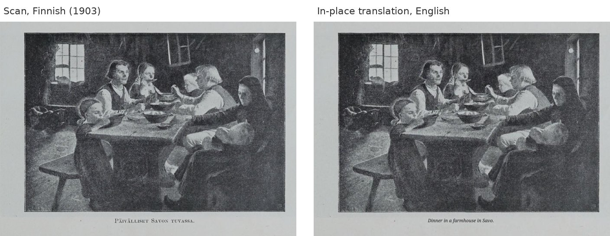
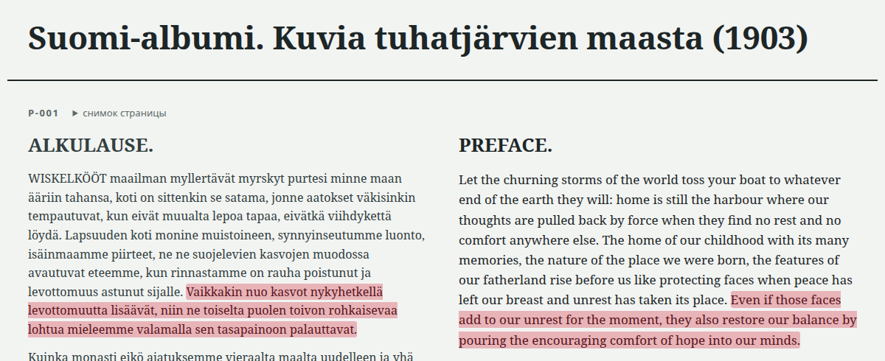

# book-translate: перевод отсканированных книг с помощью Claude Code

*English version: [README.md](README.md).*



Скилл для [Claude Code](https://claude.com/claude-code) и консольная утилита, которые
помогают перевести отсканированную книгу (PDF без текстового слоя) с сохранением вёрстки
и картинок. Он для книг, от которых остались только сканы. Claude читает изображения
страниц и переводит их, а утилита укладывает перевод обратно на страницы оригинала,
не закрывая фотографии, рисунки и выкройки. На выходе три файла:

- **PDF с переводом на странице**: текст оригинала на каждой странице заменён переводом
  в той же вёрстке;
- **двуязычный PDF**: скан страницы слева, перевод справа;
- **читалка**: один HTML-файл, который открывается без интернета, с оригиналом и переводом
  рядом. При наведении на фразу подсвечивается её пара, а у слов, в которых переводчик
  сомневался, есть подсказка с его догадкой и, после проверки, с вердиктом по словарю.



Конвейер справляется с тем, что трудно даётся на сканах иллюстрированного нон-фикшна:
цветными фотографиями, выкройками, начерченными по сетке, подписями под углом, сносками,
цитатами и песнями в несколько строф. Его собирали на финской книге о народном костюме
в 222 страницы с выкройками и главой финских и карельских свадебных песен. Обе части
переведены на русский.

## Быстрый старт с Claude Code

```bash
git clone https://github.com/olyamasaeva/book-translate ~/.claude/skills/book-translate
cd ~/.claude/skills/book-translate && uv sync
```

Потом попросите Claude Code, например:

- «Переведи book.pdf с немецкого на английский, фотографии сохрани»
- «Сделай двуязычный PDF из этой отсканированной главы»
- «Переведи эту книгу с финского на русский прямо на странице»

или вызовите скилл напрямую: `/book-translate`. Порядок работы, по которому идёт Claude,
описан в [SKILL.md](SKILL.md).

На картинках-примерах страницы альбома *Suomi-albumi: kuvia tuhatjärvien maasta* (Хэнкок,
Мичиган, 1903). Альбом находится в общественном достоянии и лежит в
[Internet Archive](https://archive.org/details/suomialbumikuvia00unse).

## Чем отличается от существующих переводчиков PDF

PDFMathTranslate, BabelDOC и похожие инструменты лучше всего работают с PDF, где уже есть
текстовый слой, и кладут перевод на белую подложку. Этот проект рассчитан на другой
случай:

- Текст читается с изображения страницы. OCR нужен только затем, чтобы найти, где стоит
  каждый блок текста, и источником перевода не служит.
- Блок перевода никогда не ложится на фотографию, даже на светлое цветное фото шёлка
  или вышивки.
- На выкройках блоки прозрачные. Буквы оригинала стираются со скана, а линии сетки и
  длинные штрихи остаются.
- Однострочная подпись на перекошенном скане получает блок, повёрнутый на тот же угол.
- Сноски разбиваются по одной на строку («номер — текст»), а цитаты и песни из
  нескольких строф распознаются как один блок.
- Шаг `check` считывает итоговую вёрстку из Chrome и считает дефекты: блоки на фото,
  наложенные друг на друга блоки, пустые блоки, текст, ужатый меньше чем до 75%, текст,
  который не поместился, и уверенно распознанные слова оригинала, которые всё ещё видны.
  Видимые слова считаются по OCR скана, поэтому проверка одинаково работает для любого
  исходного языка.

## Конвейер

```
book.pdf ──pages──► pages/p-NNN[a|b].jpg
                         │
           translation by reading the page images
           (a multimodal model or a human)
                         ▼
               translation/p-NNN.json ──bilingual──► bilingual PDF
                         │
       layout (text blocks, ink and photo masks, OCR per block)
                         ▼
               layout/blocks, layout/rotated ──inplace──► in-place PDF
                                                              │
                                                     check ◄──┘
```

## Без Claude Code

Утилита сама не обращается ни к какому сервису перевода. Перевод страниц может сделать
Claude (см. [SKILL.md](SKILL.md)), другая модель или человек. Утилите нужен только
JSON-файл на каждую страницу.

```bash
uv sync
cp conf/book.example.yaml data/<book>/book.yaml       # then edit it
uv run book-translate pages     --book data/<book>/book.yaml book.pdf
# translate the pages into data/<book>/translation/ (see below)
uv run book-translate bilingual --book data/<book>/book.yaml [--force]
nice -n 19 uv run book-translate layout --book data/<book>/book.yaml --jobs 2
uv run book-translate inplace   --book data/<book>/book.yaml [--pages p-023a,p-041b --out sub.pdf] [--force]
uv run book-translate check     --book data/<book>/book.yaml
uv run book-translate reader    --book data/<book>/book.yaml [--force]   # offline HTML: original and translation side by side, hover highlights pairs
uv run book-translate compress  finished.pdf          # downsample scans to 150 dpi → finished-compressed.pdf
```

`pages` делит развороты на половины `a` (левая) и `b` (правая) и сообщает, есть ли в PDF
текстовый слой. `layout` работает медленно, по несколько секунд на страницу, и кеширует
результаты в `layout/`. Чтобы пересобрать только исправляемые страницы, используйте
`inplace --pages`. Готовый PDF перезаписывается только с флагом `--force`. HTML, который
печатает Chrome, сохраняется в `<workdir>/build/`, оттуда его и читает `check`.

Системные зависимости: poppler (`pdftoppm`, `pdftotext`), Tesseract 5 с установленным
исходным языком, Chrome или Chromium и Ghostscript. Chrome ищется под обычными именами
и в стандартных путях установки на Linux, macOS и Windows. Tesseract берётся из `PATH`,
если в конфиге не указан другой путь. Если программы нет или она падает, команда
останавливается и выводит имя программы и её ошибку, а не выдаёт пустой результат.

## Конфиг книги

Всё, что относится к конкретной книге, лежит в `book.yaml`. Относительные пути
считаются от папки, где лежит сам файл. Язык книги нужно указать явно, без него конфиг
не загрузится:

| Поле | Значение |
|---|---|
| `ocr_lang` | код языка оригинала в Tesseract (`eng`, `deu`, `rus`, …) |
| `source_lower`, `source_upper` | алфавит оригинала, по нему на скане узнаются его слова |
| `target_letters` | алфавит перевода |
| `target_lang` | язык перевода, идёт в атрибут `lang` документов |
| `notes_headings` | заголовок блока сносок в переводе |
| `page_width_mm`, `page_height_mm` | размер страницы; высота по умолчанию берётся по медианному соотношению сторон сканов |
| `spreads` | `auto` (делить изображения шире 1,1 своей высоты), `always` или `never` |
| `quote_open`, `quote_close` | кавычки обоих языков |
| `attribution_source`, `attribution_target` | слова, с которых начинается подпись к цитате («Загадка», «Песня») |
| `source_names` | имена авторов в сносках и их написание на языке перевода |
| `service_words`, `credit_words` | единицы измерения и слова из подписей с авторством фото в оригинале |
| `retypeset_kinds`, `retypeset_ranges` | страницы, которые набираются заново: оглавление, словари, таблицы |
| `labels` | слова, которые печатаются в PDF («с.», «ещё не переведено», типы страниц); по умолчанию английские |
| `editorial_patterns` | регулярные выражения, которые вырезаются из перевода, например пометки переводчика вроде «[пересказ]» |
| `note_boilerplate` | фрагменты, по которым из примечаний переводчика убираются служебные фразы |
| `title` | титульная страница двуязычного PDF в виде HTML |
| `tesseract`, `chrome` | какие программы запускать |

Пример: `conf/book.example.yaml`.

## Формат перевода страницы

Один JSON-файл на страницу:

```json
{"page": "p-007a",
 "printed": "12",
 "kind": "text | photo | pattern | mixed | blank | cover | toc",
 "source": "original text, paragraphs separated by a blank line",
 "translation": "translation with the same paragraph structure",
 "captions": [{"source": "caption as printed", "translation": "translated caption"}],
 "notes": "translator's notes"}
```

Имена полей одинаковы для любой пары языков. Файлы со старыми ключами `fi`/`ru` тоже
читаются. Полные правила для переводчика (колонки, заголовки, цитаты, сноски, надписи на
выкройках) лежат в `docs/translation-instruction.md`.

## Безопасность

Переводы и вывод OCR считаются недоверенным текстом:

- Всё, что вставляется в генерируемый HTML, экранируется, в том числе в скрипте
  подгонки текста, который работает в браузере.
- В каждом документе задана Content Security Policy. Выполняется только скрипт подгонки,
  разрешённый по хешу. Картинки допускаются только как `data:` URL, доступ к сети и
  файлам закрыт. Обработчик событий, попавший в перевод, не выполнится.
- Chrome запускается с включённой песочницей и каждый раз с новым профилем.
- Файлы сборки записываются атомарно внутри папки книги, а не в общий временный каталог.
- Идентификаторы страниц (`p-012a`) и короткое имя книги проверяются, поэтому стать
  путями они не могут.

Конфигу книги утилита доверяет, как скрипту. В нём указано, какие программы запускать
(`chrome`, `tesseract`) и куда писать PDF, а поле `title` содержит HTML. Чужой конфиг
прочитайте, прежде чем запускать.

## Структура репозитория

| Что | Где |
|---|---|
| Код | `book_translate/`: `pages`, `layout`, `bilingual`, `inplace`, `check`, `reader`, `compress`; CLI в `cli.py` |
| Пример конфига | `conf/book.example.yaml` |
| Книги | `data/<book>/`, git их игнорирует. Сканы и тексты книг защищены авторским правом и в репозиторий не попадают |
| Контракт | `SPEC.md`, пункты `BT-N`, каждый закреплён тестом в `tests/` |
| Документация | `docs/`, собирается через `mkdocs` (`uv run --extra docs mkdocs serve`) |

## Разработка

```bash
uv sync
uv run pre-commit install
uv run pytest
```

Тестам не нужны ни сеть, ни Chrome, ни книга.

## Ограничения

- Письменности справа налево и вертикальные не поддерживаются. Развороты и колонки
  всегда упорядочиваются слева направо, настройки `dir` у документов нет.
- Скрипт подгонки делит текст по пробелам, поэтому в языках без пробелов между словами
  (китайский, японский, тайский) текст нельзя укорачивать по словам.
- Кеши OCR и вёрстки не запоминают, с какого скана, языка и настроек они сделаны. После
  замены сканов или смены `ocr_lang` удалите `layout/`.
- Состояние модулей задаётся для каждой книги через `configure()`. Обрабатывайте одну
  книгу на один процесс Python.
- Перевод часто длиннее оригинала. Сначала блоки расширяются на белые поля, текст
  уменьшается, только когда свободного места не осталось, а то, что всё равно не влезло,
  попадает в отчёт `check`.
- Текст с очень широкой разрядкой букв или слов, который встречается в некоторых книгах,
  напечатанных до 1920 года, ломает поиск блоков: строки рассыпаются на отдельные слова
  и закрываются переводом лишь частично. Такие страницы набирайте заново через
  `retypeset_ranges`.
- Утилита не переводит. Страницы переводит Claude через скилл, другая модель или человек.

## Частые вопросы

**Как перевести отсканированный PDF без текстового слоя?**
Разбейте его на изображения страниц командой `book-translate pages`, переведите каждую
страницу по изображению (со скиллом это делает Claude) и соберите PDF. OCR нужен только
чтобы найти текст на странице, так что плохой скан перевод не испортит.

**Можно сохранить исходную вёрстку и фотографии?**
Да, для этого и нужен PDF с переводом на странице. Блоки перевода не закрывают фотографии
и рисунки, на выкройках и сетках блоки прозрачные, и линии сетки остаются. Если перевод
длиннее оригинала, блоки сначала расширяются на белые поля.

**Какие языки поддерживаются?**
Любой исходный язык с письмом слева направо, который Tesseract умеет читать для разметки,
на любой язык перевода с письмом слева направо. Целиком пока переведены книги с финского
на русский и с финского и карельского на русский. Картинки выше взяты из пятистраничного
демо с финского на английский.

**Нужен ли API-ключ?**
Нет. С Claude Code перевод идёт прямо в вашей сессии Claude Code. Утилита работает без
интернета.

**Можно ли публиковать перевод?**
Только если у вас есть права: книга в общественном достоянии, это ваш собственный текст
или автор согласен. Сканы и переводы в этот репозиторий никогда не коммитятся.

## Лицензия

MIT — см. [LICENSE](LICENSE).
