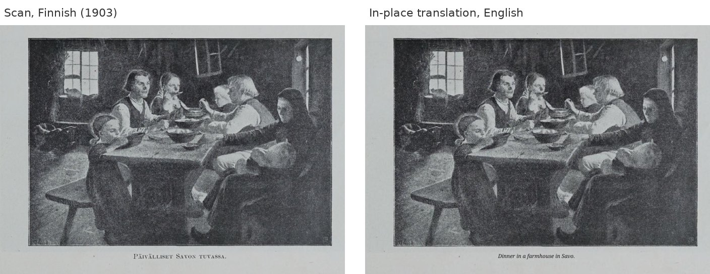
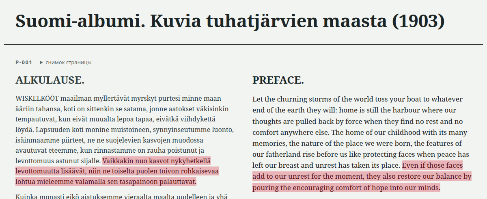

# book-translate: translate scanned books with Claude Code

A [Claude Code](https://claude.com/claude-code) skill and a command-line tool for books
that exist only as scans. Claude reads the page images and translates them. The tool lays
the translation back onto the original pages, so photos, drawings and patterns stay
uncovered, and builds an in-place PDF, a bilingual PDF and an offline HTML reader.





Install as a Claude Code skill:

```bash
git clone https://github.com/olyamasaeva/book-translate ~/.claude/skills/book-translate
cd ~/.claude/skills/book-translate && uv sync
```

Then ask Claude Code to "translate book.pdf from German into English, keep the photos", or
call `/book-translate`. Full description, comparison with PDFMathTranslate and BabelDOC,
and FAQ: [README on GitHub](https://github.com/olyamasaeva/book-translate#readme).

## Документация на русском

| Что | Где |
|---|---|
| Как переводить книгу | [guide.md](guide.md) |
| Инструкция переводчику и схема JSON | [translation-instruction.md](translation-instruction.md) |
| Справка по модулям | [api.md](api.md) |
| Контракт требований | [`SPEC.md`](https://github.com/olyamasaeva/book-translate/blob/main/SPEC.md) |
| Лог изменений | [`CHANGELOG.md`](https://github.com/olyamasaeva/book-translate/blob/main/CHANGELOG.md) |

Example pages: *Suomi-albumi: kuvia tuhatjärvien maasta* (Hancock, Michigan, 1903), public
domain, [Internet Archive](https://archive.org/details/suomialbumikuvia00unse).
